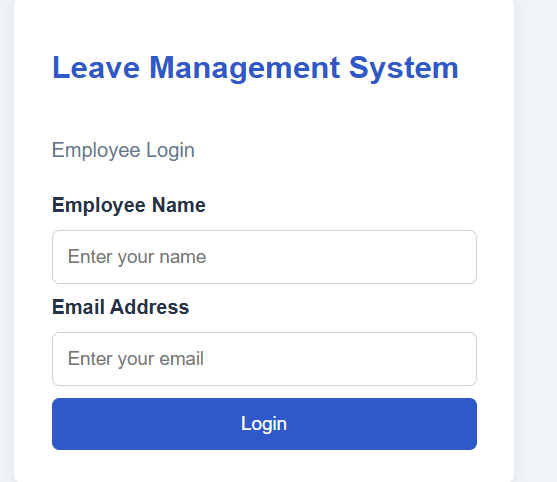
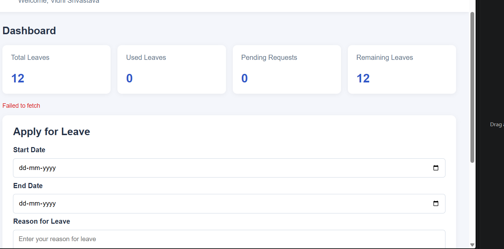
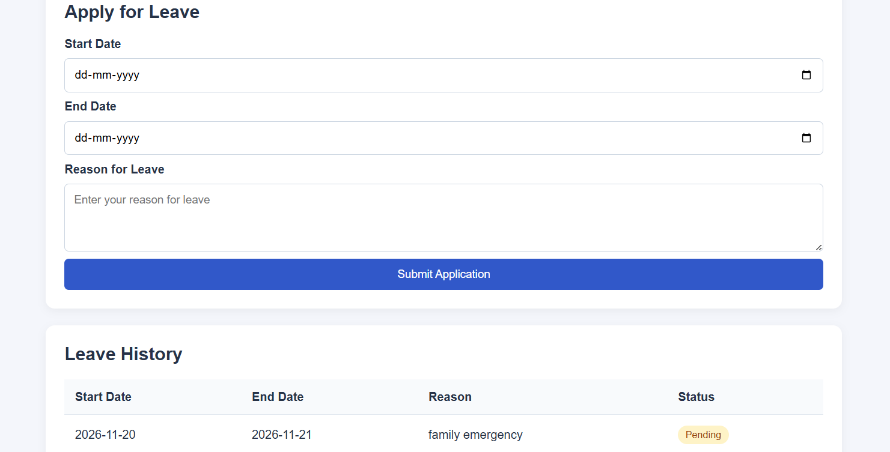

# Leave Management System

A simple full stack Leave Management System where employees can login, check their leave balance, apply for leaves and check their leave application history.

## Features

- **Employee Login:** Fake authentication of employee using their name and email.
- **Dashboard:** Shows total, taken, pending and remaining leaves.
- **Apply for Leaves:** Submit leave applications along with start date, end date and reason.
- **Leave History:** Shows leave applications submitted previously.
- **Application Status:** Shows leave application of the employee having Pending status.
- **Backend API:** Express.js API to submit and fetch leave applications.

## Tech Stack

**Frontend**
- React.js
- JavaScript
- CSS
- Vite

**Backend**
- Node.js
- Express.js
- CORS
- REST API

## Project Structure

```text
project/
├── frontend/
│   ├── src/
│   │   ├── assets/
│   │   ├── components/
│   │   │   ├── LoginPage.jsx
│   │   │   ├── LeaveForm.jsx
│   │   │   └── LeaveHistory.jsx
│   │   ├── pages/
│   │   │   └── Dashboard.jsx
│   │   ├── services/
│   │   │   └── leaveService.js
│   │   ├── utils/
│   │   │   └── dateUtils.js
│   │   ├── App.jsx
│   │   ├── App.css
│   │   ├── index.css
│   │   └── main.jsx
│   └── package.json
│
├── backend/
│   ├── routes/
│   │   └── leaveRoutes.js
│   ├── server.js
│   └── package.json
│
└── README.md
```

## Installation & Setup

### 1. Clone the repository

```bash
git clone YOUR_GITHUB_REPOSITORY_URL
cd YOUR_PROJECT_FOLDER
```

### 2. Start the Backend

```bash
cd backend
npm install
npm run dev
```

The backend server will run on:

`http://localhost:5000`

### 3. Start the Frontend

Open a new terminal:

```bash
cd frontend
npm install
npm run dev
```

Open the local URL that is displayed by Vite, usually:

`http://localhost:5173`

## API Endpoints

| Method | Endpoint | Description |
|---|---|---|
| GET | `/` | Backend server status check |
| GET | `/api/leaves?email=employee@example.com` | Fetches leave history of employee |
| POST | `/api/leaves` | Submit leave application |

## Application Workflow

1. The employee logs in using their name and email.
2. The employee views their leave dashboard.
3. The employee submits leave application.
4. The backend API validates and saves the application.
5. The application will be shown in leave history having Pending status.
6. The pending request count in the leave dashboard will be updated.

## Data Storage

In this project, in-memory storage is being used in the backend. The leave records can be fetched only while the backend process is running and are reset on server shutdown.

## Future Enhancements

- Databse implementation for storing leave records permanently.
- Admin dashboard for approving/rejecting applications.
- Authentication for secure logging in.
- Email notifications for the leave application statuses.

## Author

Made as a Leave Management System project.

## Application Screenshots

### 1. Employee Login


### 2. Employee Dashboard


### 3. Leave Application and History
